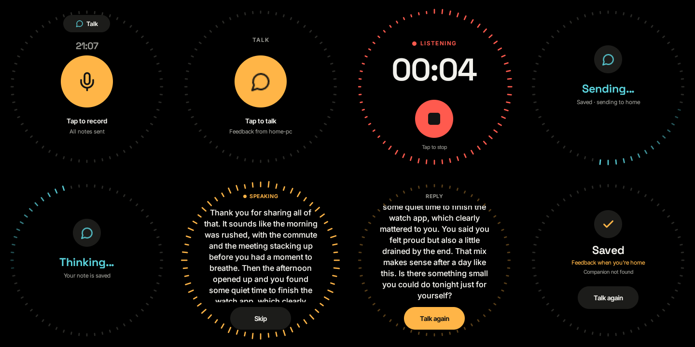

# Orbit

A home-screen launcher and voice-note diary for a cheap round Android smartwatch, plus a laptop
companion that transcribes, journals and talks back.



- **Watch app** (Kotlin, Jetpack Compose, one APK) for an "H10" round 360 × 360 Android 8.1 watch
  (not Wear OS, no Google services assumed):
  - **Audio diary** — record a note in one press; crash-safe recording in its own process (ADTS `.aac`);
    queued uploads to the companion over home Wi-Fi only, with HMAC-verified server discovery
    (last IP → mDNS → subnet scan) and QR pairing.
  - **Talk** — journaling with spoken feedback: tap, speak, hear a short reflective reply; conversations
    continue across days; history and replays cached on the watch.
  - **Launcher** — JSON watch faces (hot-reloaded), round app grid / list, quick settings, tiles,
    notifications, inbox, over-the-air app updates from the companion.
- **Companion** (`companion/`, Python, FastAPI) on the laptop:
  - receives notes, transcribes them (faster-whisper), writes one Markdown diary page per day into an
    Obsidian vault;
  - **Talk** replies via Codex (headless) and Piper text-to-speech, with recall over past notes
    (SQLite FTS5 + local multilingual embeddings), confirm-before-act actions on BB workspaces, an inbox
    for the watch, and a local web UI.

## Layout

| Path | What |
|---|---|
| `app/`, `core/`, `feature-voice/`, `feature-launcher/` | Android modules (Gradle Kotlin DSL) |
| `companion/` | Orbit Notes companion (uv, FastAPI, Typer CLI `orbit-notes`) — see its README |
| `docs/` | Specs and decisions: start with `PLAN.md`, then `voice-notes.md`, `companion.md`, `talk.md`, `launcher.md`, `memory.md`, `device-facts.md` |
| `design/` | HTML mockups (400 px grid) the screens are built from |

## Build

```
./gradlew :app:assembleRelease          # watch APK (minSdk 27)
cd companion && uv sync && uv run pytest
companion/deploy/install.sh             # run the companion as a systemd user service
```

Built for one specific watch and one person's setup; expect to adapt `docs/device-facts.md` assumptions
for other hardware.

## License

MIT — see [LICENSE](LICENSE).
